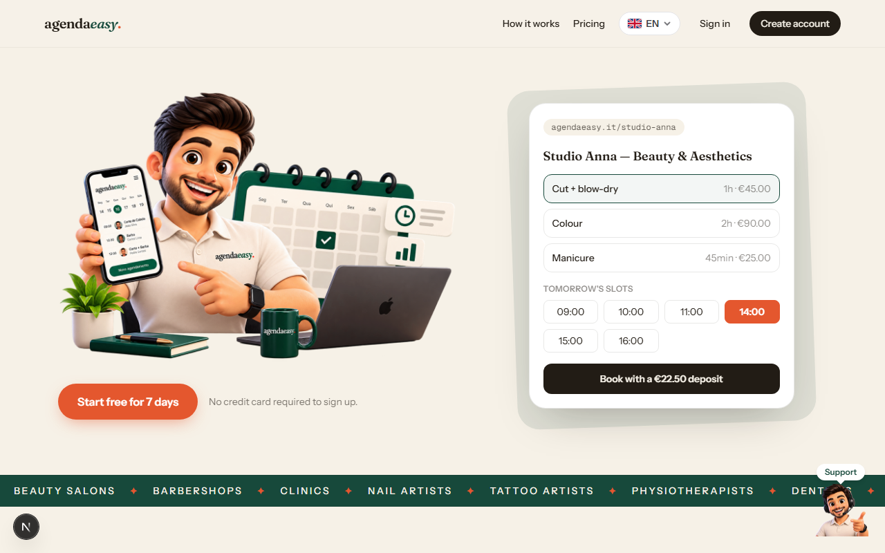
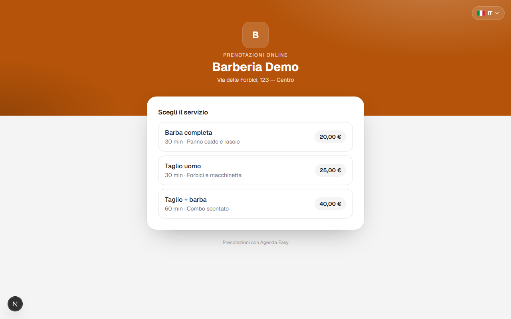
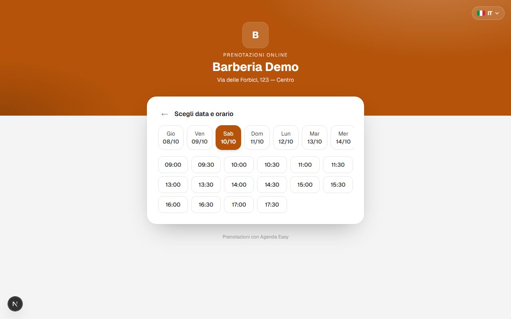
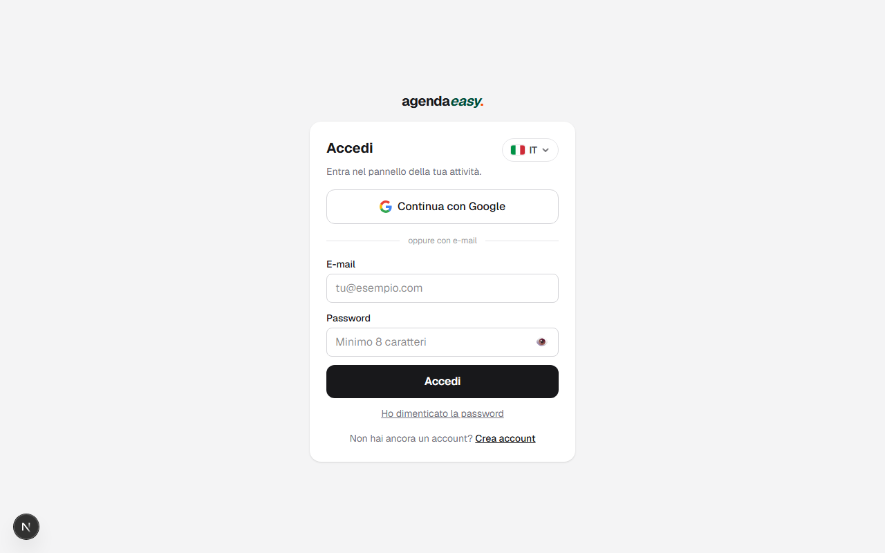
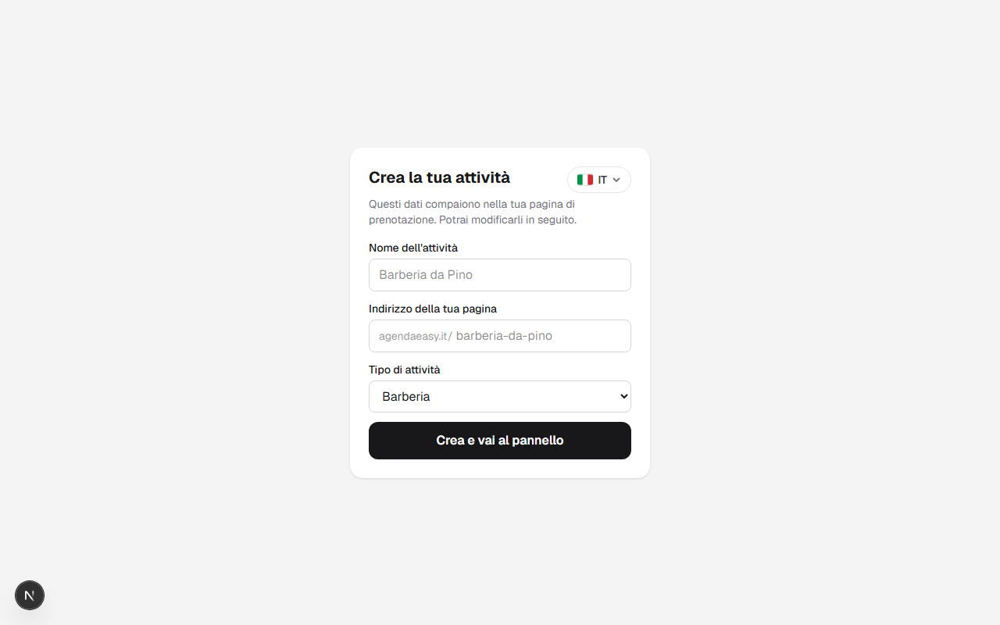
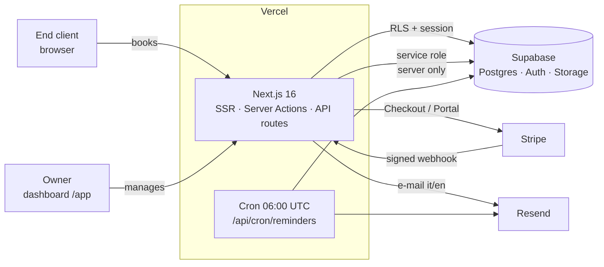
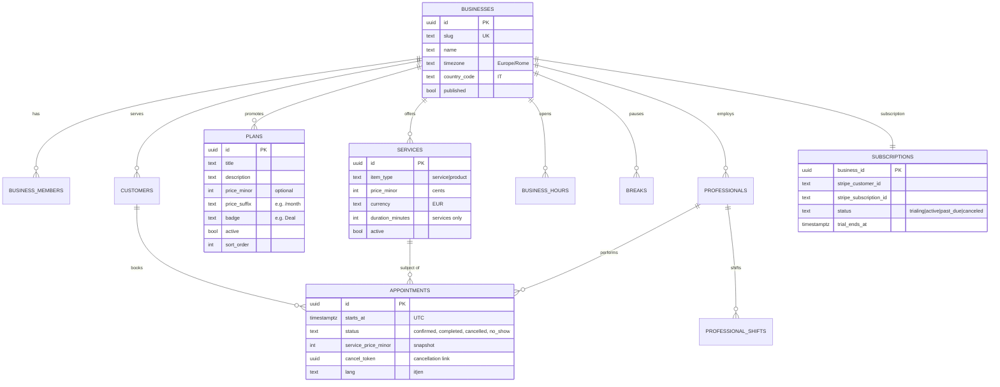
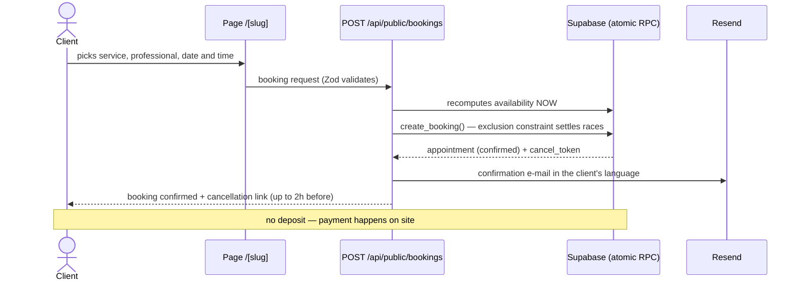

# Agenda Easy 🇮🇹

> **Full agenda, WhatsApp at peace.** Online booking SaaS for any appointment-based business — barbershops, salons, beauticians, tattoo artists, physiotherapists and more — with a product showcase and editable plans/promotions.

🇮🇹 **[Versione italiana](README.md)**


The client picks service, professional and time on their own and the booking lands in the agenda **already confirmed** — payment happens on site. The business can also showcase the **products** it sells and create **tailored plans and promotions** (monthly subscription, quiet-day discounts, "bring 3 friends", bundles…), all editable for any niche. **Bilingual UI (Italian/English)**, **EUR** currency, **Europe/Rome** timezone.

---

## 🎥 Demo

**[▶ Watch the demo video](docs/media/demo.webm)** — landing, language switch, booking flow and onboarding.

| Landing (Italian) | Landing (English) |
|---|---|
|  |  |

| Public booking page | Picking a time |
|---|---|
|  |  |

| Sign in | Business onboarding |
|---|---|
|  |  |

---

## ✨ Features

- **Personalised public page** for every business (`agendaeasy.it/your-business`): logo, cover, brand colour, services with photos
- **Instantly confirmed bookings**: no upfront payment, the client pays on site; self-service cancellation up to 2h before
- **Product showcase**: besides bookable services, the business displays the products it sells (photo, price, description)
- **Editable plans & promotions**: monthly subscription, midweek discount, "bring 3 friends", bundles — quick prefilled templates, every field customisable, for any niche
- **Daily agenda + monthly calendar** in the dashboard, with statuses (confirmed, completed, cancelled, no-show)
- **Team and shifts per professional**, real opening hours and breaks (e.g. lunch)
- **Monthly report**: expected revenue, most booked services
- **Transactional e-mails** (confirmation + 24h reminder) in the client's language, with a secure cancellation link (up to 2h before)
- **SaaS subscription via Stripe**: Checkout (€9.90/month, 7-day trial), lifecycle webhooks, Customer Portal
- **Bilingual it/en** with a persistent 🇮🇹/🇬🇧 switcher (cookie, 1 year) on every page — e-mails included
- **Sign in with Google** or e-mail/password (Supabase Auth)

## 🧱 Stack

| Layer | Technology |
|---|---|
| Frontend + Backend | Next.js 16 (App Router, Server Components, Server Actions, Turbopack) |
| UI | React 19 · Tailwind CSS 4 · GSAP |
| Database / Auth / Storage | Supabase (Postgres 17 + RLS, Auth, Storage) |
| Payments | Stripe (Checkout subscription, Webhooks, Customer Portal) |
| E-mail | Resend |
| Validation | Zod (every mutation validated on the server) |
| Hosting | Vercel (including the daily reminders cron) |

## 🗺️ Architecture



## 📐 UML

### Data model (ER)



### Sequence: public booking



### Sequence: Stripe subscription

```mermaid
sequenceDiagram
    actor T as Owner
    participant B as /app/billing (Server Action)
    participant S as Stripe
    participant W as /api/webhooks/stripe
    participant DB as Supabase

    T->>B: "Subscribe now"
    B->>S: Checkout Session (subscription, remaining trial)
    S-->>T: Stripe payment page
    T->>S: pays (card, SEPA, ...)
    S->>W: checkout.session.completed / invoice.paid (verified signature)
    W->>DB: subscriptions.status = active
    Note over T,DB: renewals, failures and cancellations arrive via webhook;<br/>self-service management goes through the Customer Portal
```

## 📂 Project structure

```
src/
├── app/
│   ├── page.tsx              # bilingual landing
│   ├── [slug]/               # public page: booking + plans + products
│   ├── annulla/[id]/         # cancellation via cancel_token
│   ├── app/                  # dashboard (agenda, services/products, plans, team, hours, report, settings)
│   │   └── billing/          # Stripe subscription (checkout + portal)
│   └── api/
│       ├── public/           # availability + bookings (server is the authority)
│       ├── webhooks/stripe/  # subscription lifecycle
│       └── cron/reminders/   # 24h reminders (Vercel Cron)
├── components/               # language switcher, support chat, auth forms
└── lib/
    ├── i18n/                 # it/en via cookie (server + client + action messages)
    ├── availability/         # slot engine (shifts ∩ hours − breaks − busy)
    ├── billing/              # plan, trial, access policy
    ├── dates/ money/         # Intl it-IT/en-GB, EUR in cents
    └── supabase/ stripe/     # typed clients (session / admin / stripe)
supabase/migrations/          # full schema + RLS + hardening (14 migrations)
```

## 🚀 Local setup

```bash
npm install
cp .env.example .env.local    # fill in the keys (see table)
npx supabase link --project-ref <ref> && npx supabase db push
npm run dev                   # http://localhost:7778
```

| Variable | Description |
|---|---|
| `NEXT_PUBLIC_SUPABASE_URL` / `NEXT_PUBLIC_SUPABASE_ANON_KEY` | Supabase project |
| `SUPABASE_SECRET_KEY` | service role — server only |
| `NEXT_PUBLIC_SITE_URL` | `https://agendaeasy.it` in production |
| `STRIPE_SECRET_KEY` / `STRIPE_PRICE_ID` / `STRIPE_WEBHOOK_SECRET` | SaaS subscription |
| `RESEND_API_KEY` / `EMAIL_FROM` | transactional e-mails |
| `CRON_SECRET` | protects the reminders cron |

Stripe webhooks locally: `stripe listen --forward-to localhost:7778/api/webhooks/stripe`

## 🔒 Security

- **Per-tenant RLS** on every table + column grants for `anon` (phone numbers and client data are never publicly readable)
- **The server is the authority**: prices, durations and availability always recomputed server-side; concurrent bookings settled by a Postgres exclusion constraint
- **Stripe webhook** verified on the raw body signature, fail-closed without the secret
- **Cancellation** authenticated by a per-booking secret token, with a 2h limit
- Security headers (HSTS, X-Frame-Options, nosniff, Referrer-Policy, Permissions-Policy)

## 🗺️ Roadmap

See the [Issues](../../issues) for the roadmap: automatic VAT with Stripe Tax, rate limiting, CSP, E2E tests in CI and more.

## 📄 License

[MIT](LICENSE) — Developed by **[Kallebe Gallo](https://github.com/kallebesiqueira-dev)**
